<!-- Header banner -->

<!-- AI systems technology icons -->

  
  
  
  
  
  

 

<!-- 

  

 -->

  

<!-- Introduction -->

 
 

<!-- GitHub activity -->

  
  

 

  

 

<!-- GitHub metrics -->

  

 

<!-- Pikachu -->

  

<!-- Footer banner -->

